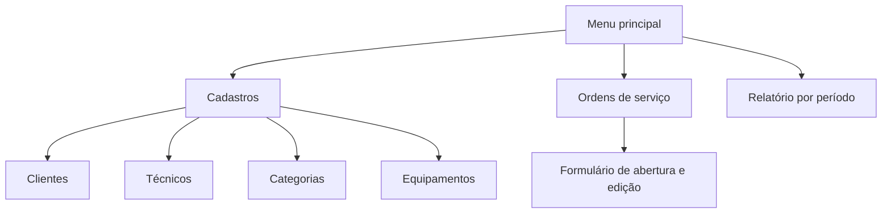
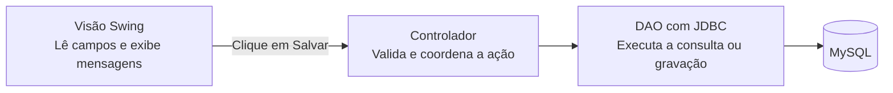

# Assistência Técnica

Sistema Java Swing com MySQL para assistência técnica de celulares, PCs, notebooks e videogames. A **ordem de serviço (OS)** acompanha o aparelho desde a entrada até o encerramento do atendimento.

## Banco de dados

Execute os scripts no MySQL 8.0.16 ou superior, em ordem, pelo MySQL Workbench ou pelo cliente `mysql`.

1. [`01_estrutura.sql`](sql/01_estrutura.sql) cria o banco `assistencia_tecnica`, as tabelas e a visão com JOIN. Também ajusta tabelas já existentes para permitir cadastrar cliente e equipamento somente pelo nome na OS, preservando os registros.
2. [`02_dados_demonstracao.sql`](sql/02_dados_demonstracao.sql) insere dados fictícios para celular, PC, notebook e videogame. Execute uma vez em um banco recém-criado.
3. [`03_consultas.sql`](sql/03_consultas.sql) lista as ordens e gera os dados do relatório por período de abertura. Altere `@inicio` e `@fim` para consultar outras datas.
4. [`04_login_tecnicos.sql`](sql/04_login_tecnicos.sql) atualiza bancos existentes para o login: adiciona senha protegida, perfil de administrador e e-mail único para técnicos. Execute este script também nos computadores dos demais integrantes. Os técnicos existentes recebem acesso somente depois de um administrador definir suas senhas.

Para aplicar a atualização do cadastro direto na OS em um banco já existente, execute novamente o `01_estrutura.sql`. Ele torna opcionais o telefone do cliente e a categoria e marca do equipamento, e atualiza a visão para incluir aparelhos sem esses dados. O `02_dados_demonstracao.sql` permanece reservado à carga inicial de dados fictícios.

As chaves estrangeiras bloqueiam a exclusão de categorias vinculadas a equipamentos e de cadastros vinculados a ordens. Cada ordem guarda o cliente que solicitou aquele atendimento.

## Conexão Java com o MySQL

O MySQL Connector/J 8.4.0 está em `lib/` e já está incluído nas bibliotecas do projeto NetBeans.

Configure as variáveis de ambiente **do usuário** no Windows:

| Variável | Valor |
| --- | --- |
| `MYSQL_USUARIO` | Seu usuário do MySQL; para teste local, pode ser `root`. Se omitida, usa `assistencia`. |
| `MYSQL_SENHA` | A senha desse usuário no MySQL. Não coloque a senha no código nem no Git. |
| `MYSQL_URL` | Opcional. Padrão: `jdbc:mysql://127.0.0.1:3306/assistencia_tecnica`. |

Feche todas as janelas do NetBeans e abra novamente após configurar as variáveis.
No projeto, abra `src/br/com/assistencia/dao/TesteConexao.java` e execute o arquivo com **Shift+F6**.
O teste informa o banco, o usuário autenticado, a versão do MySQL e a quantidade de categorias.
Ele apenas consulta dados. Caso a tabela `categoria_equipamento` não exista, execute primeiro o script de estrutura indicado acima.

## Executar a aplicação

Execute o projeto com **F6**. A classe principal é `br.com.assistencia.view.TelaLogin`.
Entre com o **e-mail e a senha de um técnico cadastrado**. Essas credenciais são diferentes do usuário e da senha do MySQL configurados nas variáveis de ambiente.

No primeiro uso, clique em **Primeiro Acesso** no rodapé do login e preencha os dados do gerente. Assim que o cadastro for concluído, entre com o e-mail e a senha escolhidos. O gerente recebe o perfil de administrador. Se o banco já tiver um administrador, o sistema informa que o primeiro acesso foi configurado.

Após entrar, o menu permite gerenciar clientes, categorias, equipamentos e ordens de serviço, além de consultar o relatório por período. Administradores também acessam **Gerenciar técnicos**, onde podem cadastrar técnicos, definir senhas e conceder o perfil de administrador. Técnicos comuns não acessam esse cadastro. A aplicação impede que um administrador exclua a própria conta ou remova seu próprio perfil.

Antes de cada consulta ou alteração, o sistema verifica no banco se o técnico conectado ainda existe. Se outro administrador excluir seu cadastro, a próxima operação será bloqueada, as telas serão fechadas e o login será exibido novamente. Uma falha de conexão bloqueia a operação sem encerrar a sessão, permitindo tentar novamente quando o banco voltar.

Nos cadastros:

- **Novo** limpa o formulário para iniciar outro cadastro, com confirmação se houver alterações não salvas.
- **Salvar** grava o novo registro ou as alterações do registro em edição.
- **Editar selecionado** carrega os dados da linha escolhida, inclusive quando a tabela estiver ordenada.
- **Excluir selecionado** pede confirmação e respeita os vínculos com ordens de serviço.
- Na edição de um técnico, deixe os dois campos de senha vazios para manter a senha atual. Para cadastrar ou alterar a senha, preencha e confirme uma senha de 8 a 128 caracteres.
- **Sistema → Sair da conta** encerra a sessão e retorna ao login.
- No cadastro de clientes, somente o nome é obrigatório. No cadastro de equipamentos, somente o nome/modelo é obrigatório; os demais dados podem ser completados depois.

As oito telas têm arquivos `.form` para edição na aba Design do NetBeans: login, menu principal, clientes, técnicos, categorias, equipamentos, ordens e relatório. O modelo `Tecnico` criado pelo grupo e o DAO de categorias foram reaproveitados; o controlador de categorias recebeu validação de ID e verificação de sessão.

O padrão visual comum está em `src/br/com/assistencia/view/EstiloVisual.java`: fontes, cores, bordas, botões, campos e tabelas. Os arquivos `.form` mantêm os componentes e layouts editáveis no NetBeans. Para mudar uma característica visual em todo o sistema, ajuste esse padrão compartilhado.

## Fluxo de atendimento

1. Confira o técnico responsável. O administrador gerencia os cadastros de técnicos.
2. Abra **Ordens de serviço** e digite o nome do cliente e o nome do equipamento, sem precisar cadastrá-los antes em outras telas.
3. Selecione o técnico e o status, descreva o defeito e clique em **Salvar**. Cliente, equipamento e OS são gravados juntos; se a gravação falhar, os cadastros novos são desfeitos. A data de abertura é automática.
4. Use **Editar selecionado** para registrar diagnóstico, orçamento e andamento. O valor pode ficar vazio enquanto não houver orçamento; aceita valores como `150,00` ou `1.234,56`.
5. Marcar como **Concluída**, **Entregue** ou **Cancelada** registra o encerramento automaticamente. Alterações entre esses três status preservam o encerramento já registrado. Voltar para **Aberta**, **Em análise** ou **Em reparo** reabre a ordem e limpa essa data.
6. Em **Relatório por período**, informe as datas de abertura no formato `dd/mm/aaaa`. A consulta inclui todo o último dia e mostra a quantidade de ordens e o valor total dos serviços informados. Para conferir os dados de demonstração, use `01/10/2026` a `31/10/2026`.

Cada nova OS registra o cliente e o aparelho informados. Nomes iguais não são usados para juntar automaticamente pessoas ou aparelhos distintos. Na edição da mesma OS, nomes inalterados mantêm os vínculos existentes. Mudar um nome vincula um novo cadastro àquela OS, preservando os cadastros anteriores e outras ordens.

A tela principal apresenta os acessos em dois grupos, **Atendimento** e **Cadastros**, com botões compactos e saída da conta no rodapé.

Depois de criar um cadastro em outra janela, use **Atualizar lista** na tela aberta para carregar as novas opções dos campos de seleção. Cadastros vinculados a equipamentos ou ordens não podem ser excluídos antes de remover os vínculos.

A conexão tem limites padrão de 5 segundos para conectar e 15 segundos para aguardar uma resposta do banco. As operações são executadas em segundo plano nas telas.

As senhas são armazenadas como PBKDF2-HMAC-SHA256, com salt aleatório por senha e 600.000 iterações. Referência dos parâmetros: [OWASP Password Storage Cheat Sheet](https://cheatsheetseries.owasp.org/cheatsheets/Password_Storage_Cheat_Sheet.html).

## Testar a etapa atual

Se aparecer `NoSuchMethodError` ou uma mensagem como `'boolean br.com.assistencia.dao.TecnicoDAO.ehAdministrador(int)'`, feche as janelas da aplicação, salve os arquivos e use **Limpar e Construir Projeto** no NetBeans antes de executar novamente com **F6**. Isso recompila as classes que precisam trabalhar juntas. Uma execução Java que já estava aberta pode continuar usando classes antigas mesmo depois de recompilar.

Ao atualizar o projeto em outro computador, copie ou obtenha pelo Git a versão completa, incluindo DAOs e controladores, e faça a mesma limpeza e construção antes de executar.

Compile o projeto no NetBeans e execute no PowerShell, na pasta do projeto:

```powershell
.\scripts\Testar-Projeto.ps1
```

Os testes verificam login, perfis, senhas, cadastros, vínculos, valores, abertura e encerramento das ordens e relatório. Incluem cadastro direto pelos nomes, rollback após uma falha na OS, edição sem criar registros repetidos e aparelhos sem marca/categoria no relatório. Também verificam os botões, a confirmação de descarte e o filtro do relatório até as 23h59 do último dia. As gravações de teste usam uma transação com rollback; os registros de teste não são mantidos. O MySQL pode consumir números de IDs mesmo após rollback. As imagens de conferência das telas ficam na pasta temporária do Windows.

A regressão de sessão testa a exclusão de um técnico enquanto ele está conectado: bloqueio nos módulos, tentativa de gravação em uma tela já aberta, retorno ao login e falha de conexão sem encerrar indevidamente a sessão.

## Mapa de telas



| Tela | Campos ou seleção | Componentes e ações |
| --- | --- | --- |
| Clientes | Nome obrigatório; telefone e e-mail opcionais | `JTextField` para os campos e `JTable` para a lista. Novo, salvar, editar e excluir. |
| Técnicos | Nome, telefone, e-mail | Mesmo desenho da tela de clientes, com os dados da tabela de técnicos. |
| Categorias | Nome | Campo de texto e tabela. Exemplos do script incluem Celular, PC, Notebook e Videogame. |
| Equipamentos | Nome/modelo obrigatório; categoria, marca e número de série opcionais | `JComboBox` para categoria, campos de texto e tabela. |
| Ordens de serviço | Nomes do cliente e equipamento, técnico, defeito e status; diagnóstico e valor opcionais | Campos de texto para cadastrar cliente e aparelho na OS, combos para técnico e status, áreas de texto e tabela. Datas automáticas. |
| Relatório por período | Data inicial e final | Campos de data, botão **Consultar** e tabela com número da OS, abertura, cliente, equipamento, técnico, status e valor. |

Para cada cadastro, use **Novo** para limpar o formulário e **Salvar** para inserir ou atualizar. **Editar** carrega a linha selecionada e **Excluir** pede confirmação. Na listagem de ordens, apresente os nomes vindos de `vw_ordens_servico`. Nos combos, exiba nomes ou modelos e use o ID correspondente ao salvar.

## Relacionamentos


## Caminho de uma ação no MVC



O modelo representa os dados do domínio, como cliente e ordem de serviço. Depois de salvar, o controlador solicita a atualização da lista e a visão exibe o resultado na tabela.

## Ordem sugerida para validar o sistema

1. Prepare o banco, configure as variáveis do MySQL e crie o primeiro administrador. O driver já está incluído.
2. Teste login, perfis e os cadastros de clientes e técnicos.
3. Teste categorias e equipamentos, incluindo o bloqueio de exclusão de categorias vinculadas.
4. Abra uma OS digitando somente os nomes do cliente e aparelho e percorra as alterações de status até a entrega. Confira o encerramento automático e o bloqueio de exclusão de cadastros vinculados.
5. Consulte o relatório por data de abertura, incluindo um intervalo sem resultados e o último dia do período.
