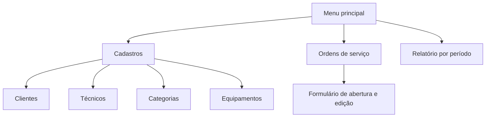
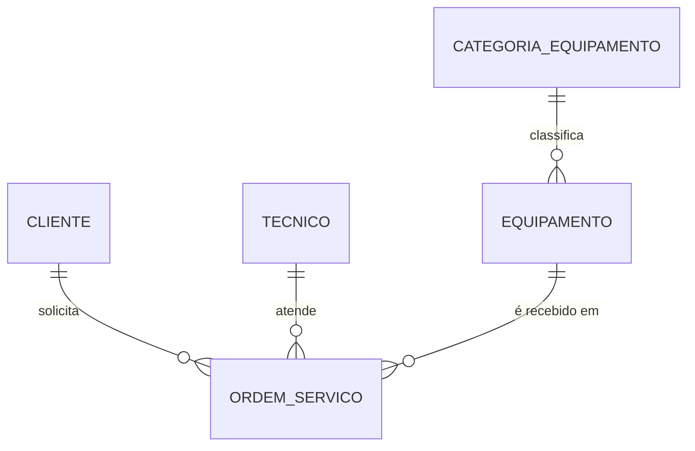
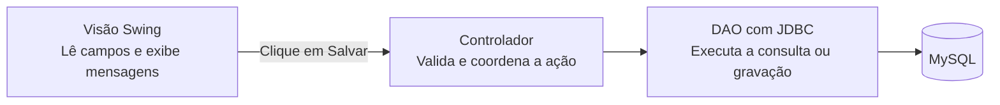

# Assistência Técnica

Sistema Java Swing com MySQL para assistência técnica de celulares, PCs, notebooks e videogames. A **ordem de serviço (OS)** acompanha o aparelho desde a entrada até o encerramento do atendimento.

## Banco de dados

Execute os scripts no MySQL 8.0.16 ou superior, em ordem, pelo MySQL Workbench ou pelo cliente `mysql`.

1. [`01_estrutura.sql`](sql/01_estrutura.sql) cria o banco `assistencia_tecnica`, as tabelas e a visão com JOIN que exibe os nomes e os dados dos equipamentos.
2. [`02_dados_demonstracao.sql`](sql/02_dados_demonstracao.sql) insere dados fictícios para celular, PC, notebook e videogame. Execute uma vez em um banco recém-criado.
3. [`03_consultas.sql`](sql/03_consultas.sql) lista as ordens e gera os dados do relatório por período de abertura. Altere `@inicio` e `@fim` para consultar outras datas.
4. [`04_login_tecnicos.sql`](sql/04_login_tecnicos.sql) atualiza bancos existentes para o login: adiciona senha protegida, perfil de administrador e e-mail único para técnicos. Execute este script também nos computadores dos demais integrantes. Os técnicos existentes recebem acesso somente depois de um administrador definir suas senhas.

As chaves estrangeiras bloqueiam a exclusão de categorias vinculadas a equipamentos e de cadastros vinculados a ordens. Cada ordem guarda o cliente que solicitou aquele atendimento.

## Conexão Java com o MySQL

O MySQL Connector/J 8.4.0 está em `lib/` e já está incluído nas bibliotecas do projeto NetBeans.

Configure as variáveis de ambiente **do usuário** no Windows:

| Variável | Valor |
| --- | --- |
| `MYSQL_USUARIO` | Seu usuário do MySQL; para teste local, pode ser `root`. Se omitida, usa `assistencia`. |
| `MYSQL_SENHA` | A senha desse usuário no MySQL. Não coloque a senha no código nem no Git. |
| `MYSQL_URL` | Opcional. Padrão: `jdbc:mysql://127.0.0.1:3306/assistencia_tecnica`. |

Feche todas as janelas do NetBeans e abra novamente após configurar as variáveis.
No projeto, abra `src/br/com/assistencia/dao/TesteConexao.java` e execute o arquivo com **Shift+F6**.
O teste informa o banco, o usuário autenticado, a versão do MySQL e a quantidade de categorias.
Ele apenas consulta dados. Caso a tabela `categoria_equipamento` não exista, execute primeiro o script de estrutura indicado acima.

## Executar a aplicação

Execute o projeto com **F6**. A classe principal é `br.com.assistencia.view.TelaLogin`.
Entre com o **e-mail e a senha de um técnico cadastrado**. Essas credenciais são diferentes do usuário e da senha do MySQL configurados nas variáveis de ambiente.

No primeiro uso de um banco sem administrador, execute uma única vez `src/br/com/assistencia/setup/PrimeiroAdministrador.java` com **Shift+F6** e preencha os dados na janela local. O utilitário recusa a criação se já existir um administrador. Nenhuma senha padrão é incluída no código ou nos scripts.

Após entrar, o menu permite gerenciar clientes, categorias, equipamentos e ordens de serviço, além de consultar o relatório por período. Administradores também acessam **Gerenciar técnicos**, onde podem cadastrar técnicos, definir senhas e conceder o perfil de administrador. Técnicos comuns não acessam esse cadastro. A aplicação impede que um administrador exclua a própria conta ou remova seu próprio perfil.

Nos cadastros:

- **Novo** limpa o formulário para iniciar outro cadastro, com confirmação se houver alterações não salvas.
- **Salvar** grava o novo registro ou as alterações do registro em edição.
- **Editar selecionado** carrega os dados da linha escolhida, inclusive quando a tabela estiver ordenada.
- **Excluir selecionado** pede confirmação e respeita os vínculos com ordens de serviço.
- Na edição de um técnico, deixe os dois campos de senha vazios para manter a senha atual. Para cadastrar ou alterar a senha, preencha e confirme uma senha de 8 a 128 caracteres.
- **Sistema → Sair da conta** encerra a sessão e retorna ao login.

As oito telas têm arquivos `.form` para edição na aba Design do NetBeans: login, menu principal, clientes, técnicos, categorias, equipamentos, ordens e relatório. O modelo `Tecnico` criado pelo grupo e o DAO de categorias foram reaproveitados; o controlador de categorias recebeu validação de ID e verificação de sessão.

## Fluxo de atendimento

1. Cadastre as categorias de aparelhos e os equipamentos, indicando categoria, marca e modelo. O número de série é opcional.
2. Cadastre o cliente e confira o técnico responsável. O administrador gerencia os cadastros de técnicos.
3. Abra **Ordens de serviço**, selecione cliente, técnico e equipamento e descreva o defeito. A data de abertura é registrada automaticamente ao salvar.
4. Use **Editar selecionado** para registrar diagnóstico, orçamento e andamento. O valor pode ficar vazio enquanto não houver orçamento; aceita valores como `150,00` ou `1.234,56`.
5. Marcar como **Concluída**, **Entregue** ou **Cancelada** registra o encerramento automaticamente. Alterações entre esses três status preservam o encerramento já registrado. Voltar para **Aberta**, **Em análise** ou **Em reparo** reabre a ordem e limpa essa data.
6. Em **Relatório por período**, informe as datas de abertura no formato `dd/mm/aaaa`. A consulta inclui todo o último dia e mostra a quantidade de ordens e o valor total dos serviços informados. Para conferir os dados de demonstração, use `01/10/2026` a `31/10/2026`.

Depois de criar um cadastro em outra janela, use **Atualizar lista** na tela aberta para carregar as novas opções dos campos de seleção. Cadastros vinculados a equipamentos ou ordens não podem ser excluídos antes de remover os vínculos.

A conexão tem limites padrão de 5 segundos para conectar e 15 segundos para aguardar uma resposta do banco. As operações são executadas em segundo plano nas telas.

As senhas são armazenadas como PBKDF2-HMAC-SHA256, com salt aleatório por senha e 600.000 iterações. Referência dos parâmetros: [OWASP Password Storage Cheat Sheet](https://cheatsheetseries.owasp.org/cheatsheets/Password_Storage_Cheat_Sheet.html).

## Testar a etapa atual

Se aparecer `NoSuchMethodError` ou uma mensagem como `'boolean br.com.assistencia.dao.TecnicoDAO.ehAdministrador(int)'`, feche as janelas da aplicação, salve os arquivos e use **Limpar e Construir Projeto** no NetBeans antes de executar novamente com **F6**. Isso recompila as classes que precisam trabalhar juntas. Uma execução Java que já estava aberta pode continuar usando classes antigas mesmo depois de recompilar.

Ao atualizar o projeto em outro computador, copie ou obtenha pelo Git a versão completa, incluindo DAOs e controladores, e faça a mesma limpeza e construção antes de executar.

Compile o projeto no NetBeans e execute no PowerShell, na pasta do projeto:

```powershell
.\scripts\Testar-Projeto.ps1
```

Os testes verificam login, perfis, senhas, cadastros, vínculos, valores, abertura e encerramento das ordens e relatório. Também verificam os botões das novas telas, a confirmação de descarte e o filtro do relatório até as 23h59 do último dia. As gravações de teste usam uma transação com rollback; os registros de teste não são mantidos. O MySQL pode consumir números de IDs mesmo após rollback. As imagens de conferência das telas ficam na pasta temporária do Windows.

## Mapa de telas



| Tela | Campos ou seleção | Componentes e ações |
| --- | --- | --- |
| Clientes | Nome, telefone, e-mail | `JTextField` para os campos e `JTable` para a lista. Novo, salvar, editar e excluir. |
| Técnicos | Nome, telefone, e-mail | Mesmo desenho da tela de clientes, com os dados da tabela de técnicos. |
| Categorias | Nome | Campo de texto e tabela. Exemplos do script incluem Celular, PC, Notebook e Videogame. |
| Equipamentos | Categoria, marca, modelo, número de série | `JComboBox` para categoria, campos de texto e tabela. |
| Ordens de serviço | Cliente, técnico, equipamento, defeito e status. Na edição, diagnóstico, valor e data de encerramento. | Combos para os cadastros e o status, `JTextArea` para defeito e diagnóstico e `JTable` para a listagem. Nova OS, editar e excluir. |
| Relatório por período | Data inicial e final | Campos de data, botão **Consultar** e tabela com número da OS, abertura, cliente, equipamento, técnico, status e valor. |

Para cada cadastro, use **Novo** para limpar o formulário e **Salvar** para inserir ou atualizar. **Editar** carrega a linha selecionada e **Excluir** pede confirmação. Na listagem de ordens, apresente os nomes vindos de `vw_ordens_servico`. Nos combos, exiba nomes ou modelos e use o ID correspondente ao salvar.

## Relacionamentos



## Caminho de uma ação no MVC



O modelo representa os dados do domínio, como cliente e ordem de serviço. Depois de salvar, o controlador solicita a atualização da lista e a visão exibe o resultado na tabela.

## Ordem sugerida para validar o sistema

1. Prepare o banco, configure as variáveis do MySQL e crie o primeiro administrador. O driver já está incluído.
2. Teste login, perfis e os cadastros de clientes e técnicos.
3. Teste categorias e equipamentos, incluindo o bloqueio de exclusão de categorias vinculadas.
4. Abra uma OS e percorra as alterações de status até a entrega. Confira o encerramento automático e o bloqueio de exclusão de cadastros vinculados.
5. Consulte o relatório por data de abertura, incluindo um intervalo sem resultados e o último dia do período.
